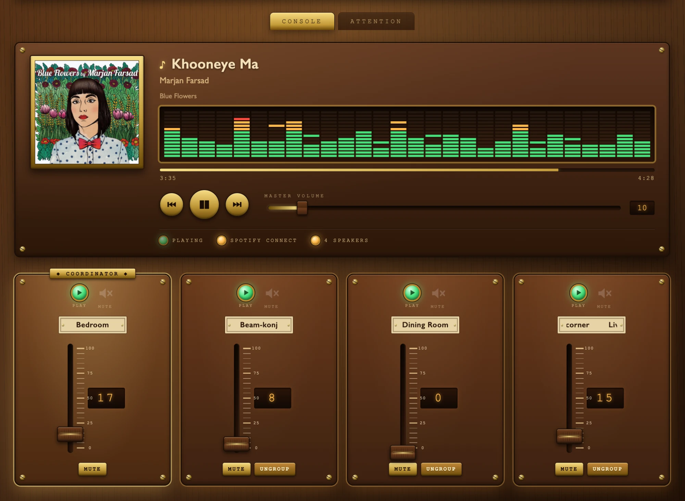
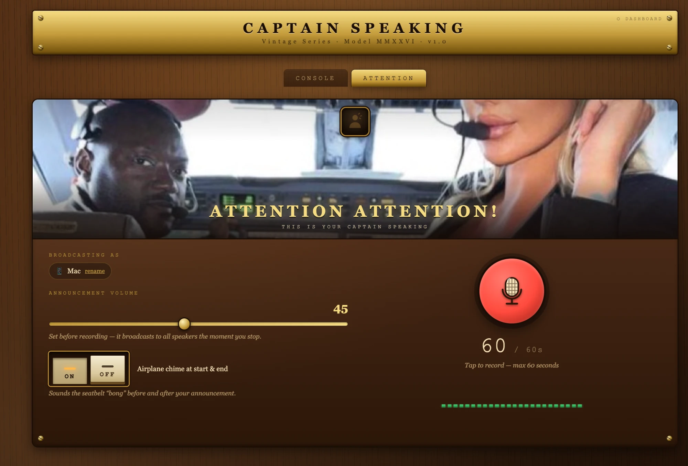

# Captain Speaking 🎛️📣

*A vintage-style web console for your Sonos speakers, with whole-home voice announcements.*

**Version 1.1** · Last updated: 18 October 2026

Created by **Reza K** ([@rkgits](https://github.com/rkgits)) · [GitHub profile](https://github.com/rkgits) · [Project board](https://github.com/users/rkgits/projects/2) · [MIT License](LICENSE)

> Captain Speaking is an independent, unofficial project. It is not affiliated with, endorsed by or sponsored by Sonos, Inc. "Sonos" is a trademark of Sonos, Inc.

**Sonos makes great speakers with a so-so control experience.**

When music is playing, you can't tell who started it or what's on. To turn the volume up or down you have to track down whoever is controlling it, and half the time they tap the wrong thing and the music stops. If you've ever lost a party playlist that way, this app is for you.

**Captain Speaking** is a small web app that runs on your own computer. Nothing to install on your phone, no account, no cloud. Open it in any browser on your home network and you get:

- 🔊 **Volume for every speaker**, one slider each, plus a group volume.
- 🔇 **Mute and unmute** any speaker.
- 🔗 **Add or remove speakers** from whatever is playing, so a room can join or leave the music in one tap.
- ▶️ **See what's playing** on each group (AirPlay, Spotify and more), with album artwork, a vintage level-meter visualizer, and play, pause, next and previous.
- 📣 **Voice announcements on all your speakers at once.** The fun part.
- 🧭 **A dashboard** (`/dashboard`) showing the network you're on, each speaker's model, firmware and announcement support, and a **Rescan for speakers** button for when you move to another Wi-Fi.

### The announcement feature (Attention / Flight Attendant tab)

Record a message in your browser, optionally wrapped in an airplane chime, and it plays through every speaker at the same time. Think "Pizza's here!", "Last call!" or "Dinner in five."

**It never interrupts your music.** The announcement plays *over* whatever is playing. The music dips for a moment while the message plays, then carries on right where it was. Nothing stops, restarts or loses its place, which makes it perfect for parties.

---

## Screenshots

**The console.** Album artwork, a vintage level-meter display, transport and master volume, indicator lamps, and one fader per speaker.



**The Attention tab.** Record a message, choose whether the airplane chime wraps it, and broadcast it over your music to every speaker at once.



---

## Contents

- [Screenshots](#screenshots)
- [Is my setup supported?](#is-my-setup-supported)
- [Quick start](#quick-start) (including start at login, stop and uninstall)
- [Everything you need to install](#everything-you-need-to-install)
- [Running on your local network](#running-on-your-local-network)
- [How it works](#how-it-works)
- [Recording from a phone](#recording-from-a-phone)
- [Configuration](#configuration)
- [Finding speakers: scan for new speakers](#finding-speakers-scan-for-new-speakers)
- [Troubleshooting](#troubleshooting)
- [Deploying as a service](#deploying-as-a-service)
- [Tests](#tests)
- [Project layout](#project-layout)
- [Security note](#security-note)
- [Contributing and security](#contributing-and-security)
- [License](#license)
- [Roadmap and credits](#roadmap-and-credits)

---

## Is my setup supported?

### Computer

| OS | Status |
|---|---|
| **macOS** | ✅ Supported. This is what the app is built and tested on. |
| **Linux** | ❌ Not yet. |
| **Windows** | ❌ Not yet. |

The app is macOS-only today because speaker discovery and some settings call macOS tools (`ipconfig getifaddr`, `arp -a`, `ping` with macOS options), and the deploy scripts use `launchctl`. Linux and Windows would need those parts rewritten. Contributions are welcome.

### The computer and the speakers must be on the same network

**The computer running this app must be on the same local network (same Wi-Fi or router, same subnet) as your Sonos speakers.** The app finds speakers by scanning your computer's subnet. It can't see speakers on another network, a guest Wi-Fi, a separate VLAN or the internet. A VPN that reroutes local traffic can also hide them.

Devices that only *open the web page*, such as phones and laptops, don't have to be on the same subnet as the speakers. They only need to reach the computer running the app.

### Sonos speakers

The app uses two parts of Sonos's local network interface:

| Feature | Uses | Needs |
|---|---|---|
| Volume, mute, grouping, play/pause/next/previous, now playing | Standard UPnP/SOAP on port `1400` | Any Sonos speaker on the network |
| **Voice announcements** | Sonos local **audioClip** API on port `1443` | A speaker that reports the `AUDIO_CLIP` capability |

In short, **announcements need an S2 speaker.** Sonos documents audio clips under an `AUDIO_CLIP` capability flag ([Sonos docs: audioClip](https://docs.sonos.com/reference/audioclip), [groups object](https://docs.sonos.com/reference/groups-object)), and the community reports that S1 firmware doesn't support the local audioClip interface ([jrule-sonos](https://github.com/seaside1/jrule-sonos)). I haven't tested S1 speakers.

Sonos sorts its products by app generation ([Sonos app version compatibility](https://support.sonos.com/en/article/sonos-s2-compatibility)):

| Group | Products |
|---|---|
| **S2 only** (announcements ✅) | Arc, Arc SL, Arc Ultra, Beam (Gen 2), Era 100, Era 100 Pro, Era 300, Five, Move 2, One SL, Ray, Roam, Roam 2, Roam SL, Sub (Gen 3), Sub 4, Sub Mini, Ace, SYMFONISK (Gen 2) |
| **S1 or S2** (announcements ✅ only when running **S2**) | Amp, Beam (Gen 1), Boost, Connect (Gen 2), Connect:Amp (Gen 2), Move, One (Gen 1 and 2), Play:1, Play:3, Play:5 (Gen 2), Playbar, Playbase, Port, Sub (Gen 1 and 2), SYMFONISK Bookshelf and Table lamp (Gen 1) |
| **S1 only** (controls ✅, announcements ❌) | Connect (Gen 1), Connect:Amp (Gen 1), Play:5 (Gen 1), Bridge, CR200, ZonePlayer models |

Tested on the author's system: Beam and three Era 100 speakers on firmware `97.2-81220`, all S2.

**Check your own speakers.** Run this against any speaker's IP. If the output contains `AUDIO_CLIP`, announcements will work on it.

```bash
curl -sk -H "X-Sonos-Api-Key: 123e4567-e89b-12d3-a456-426655440000" \
  https://<speaker-ip>:1443/api/v1/players/local/info
```

Sonos can change its firmware at any time, so this list reflects the date at the top of this file.

### Speaker names

**Room names come from Sonos, and you can't change them in this app.** The app reads each speaker's name (the "room name") straight from your Sonos system. To rename a speaker, use the official Sonos app (open the room's settings and change its name). The new name shows up here automatically.

---

## Quick start

```bash
git clone https://github.com/rkgits/captain-speaking-sonos-console.git
cd captain-speaking-sonos-console
./start.command
```

`start.command` sets everything up the first time (virtual environment and packages), then starts the server and prints the addresses to open. You can also **double-click it in Finder**.

- On the computer: <http://localhost:8787>
- On another computer or a phone, to control music: `http://<computer-ip>:8787`
- On a phone, **to record announcements**: `https://<computer-ip>:8443` (see [Recording from a phone](#recording-from-a-phone))

The script prints the exact addresses for you. To use other ports: `PORT=8788 HTTPS_PORT=8444 ./start.command`.

<details>
<summary>Prefer to do it by hand?</summary>

```bash
python3 -m venv .venv
.venv/bin/pip install -r requirements.txt
.venv/bin/uvicorn app:app --host 0.0.0.0 --port 8787
```

To find the computer's IP on macOS: `ipconfig getifaddr en0` (Wi-Fi; try `en1` if it prints nothing).
</details>

### Keep it running: start at login

Run this once, from a folder **outside** Documents, Desktop and Downloads (for example `~/captain-speaking`). macOS blocks background login items from reading those folders, and the script will tell you if you're in one.

```bash
scripts/install-launch-agent.sh
```

Captain Speaking then starts whenever you log in and restarts itself if it stops. Its log is at `~/Library/Logs/captain-speaking.log`. The computer must stay awake to serve announcements, so turn off sleep in System Settings, Energy, if it's a dedicated machine.

### Stop

- **Started with `start.command`:** press **Ctrl-C** in its window, or close the window.
- **Running at login:** `scripts/uninstall-launch-agent.sh` stops it and removes it from login items.
- **Not sure what is running?** `lsof -nP -iTCP:8787 -sTCP:LISTEN` shows the process using the port. Stop it with `kill <PID>` using the number it shows.

### Uninstall

1. Stop it with the steps above. If you installed the login item, run `scripts/uninstall-launch-agent.sh`.
2. Delete the project folder. This also deletes your saved announcements in `recordings/` and the HTTPS certificate in `certs/`. Move `recordings/` somewhere first if you want to keep them.
3. Optional: delete `~/Library/Logs/captain-speaking.log`.

Nothing else is installed on your computer. The app doesn't change your speakers or your Sonos account.

---

## Everything you need to install

### To run the app

| What | Why | How to get it |
|---|---|---|
| **macOS** | Speaker discovery uses macOS network tools | n/a |
| **Python 3.9 or newer** | Runs the server | Preinstalled with Xcode Command Line Tools, or `brew install python` |
| **`fastapi` ≥ 0.110** | Web framework | `pip`, via `requirements.txt` |
| **`uvicorn` ≥ 0.29** | Web server | `pip`, via `requirements.txt` |
| **`httpx` ≥ 0.27** | Talks to the speakers | `pip`, via `requirements.txt` |

`ipconfig`, `arp` and `ping`, which the app calls for discovery, and `lsof`, `shasum` and `openssl`, which `start.command` uses (`openssl` makes the certificate for the secure address), all ship with macOS. Recording uses your browser's microphone, so there's nothing to install for it.

The Python packages are pinned only as minimums in [requirements.txt](requirements.txt). The author's tested versions were `fastapi 0.128`, `uvicorn 0.39`, `httpx 0.28` and `pydantic 2.13` (installed automatically with FastAPI).

### To run the tests

| What | How |
|---|---|
| `pytest` ≥ 8.0, `pytest-asyncio` ≥ 0.23 | `pip install -r requirements-dev.txt` |

### To deploy as a background service (optional)

These are used by `scripts/deploy.sh` and are all part of macOS unless noted:

| What | Used for |
|---|---|
| `rsync` | Copies code into the deploy folder |
| `openssl` | Creates the self-signed HTTPS certificate |
| `launchctl` (launchd) | Starts the server at login and keeps it running |
| `caffeinate` | Keeps the Mac awake while serving |
| `curl` | Health check after a deploy |
| `sha256sum` | Detects changes in `requirements.txt` |
| `python3` + the packages above | Builds the deploy `.venv` |
| **Two launchd plist files** you create yourself | Not in this repo. See [Deploying as a service](#deploying-as-a-service). |

---

## Running on your local network

Announcements work differently from the other controls, so read this part if you want them to work.

The volume and playback buttons go one way, from the app to the speaker. An announcement goes both ways. The app saves your recording, then tells each speaker to **download it from your computer over HTTP**. If the speakers can't reach the app, the request to the speaker still succeeds, but nothing plays.

Three things must be true:

1. **Bind to all interfaces.** Use `--host 0.0.0.0`, not `127.0.0.1`. With `127.0.0.1` the controls still work from your own browser, but the speakers can't fetch the recording.
2. **Keep `PUBLIC_HTTP_PORT` equal to the port you serve on.** The app gives speakers the URL `http://<computer-ip>:$PUBLIC_HTTP_PORT/recordings/<file>`. It defaults to `8787`. If you run on another port, set it to match:
   ```bash
   PUBLIC_HTTP_PORT=8788 .venv/bin/uvicorn app:app --host 0.0.0.0 --port 8788
   ```
3. **Allow incoming connections.** If macOS asks whether Python may accept incoming network connections, choose **Allow**. A firewall that blocks the port also silences announcements.

Speakers can't use the app's self-signed HTTPS certificate, so a **plain-HTTP listener must always be running**, even if you also run HTTPS.

### Check that the speakers can reach the app

After recording something, request it the way a speaker would:

```bash
curl -s -o /dev/null -w "%{http_code}\n" http://<computer-ip>:8787/recordings/<file>.wav
```

`200` means the speakers can download it. A connection error or timeout means one of the three points above is wrong. The server log and the `/dashboard` page show `audioClip to <room> failed` when a speaker rejects the request.

---

## How it works

- **Discovery.** The app scans your subnet, asks the speakers it finds for the Sonos zone-group layout, and refreshes every 2 seconds. Room names, groups and now-playing all come from the speakers themselves.
- **Controls.** Standard Sonos UPnP calls on port `1400`.
- **Announcements.** The browser records audio and uploads it as WAV. The server saves it in `recordings/` and asks every speaker, via the Sonos audioClip API, to play it from the server's URL. The speaker plays the clip over the current audio, lowers the music while the clip plays, and then restores it. Your queue, AirPlay session and playback position are untouched.
- **Chime.** If enabled, the airplane chime is mixed into the recording itself, so the order is always chime → voice → chime.

---

## Recording from a phone

Browsers only let a page use the microphone if it is **secure**: either `localhost` or an `https://` address. This is a rule in the browser (Safari, Chrome and others), so there is no way to record over plain `http://` from a phone.

`./start.command` takes care of it. It serves the app on **two addresses** at once:

| Address | Use it for |
|---|---|
| `http://<computer-ip>:8787` | Controlling music from any device. The speakers also download your announcements from this one. |
| `https://<computer-ip>:8443` | **Recording announcements from a phone** |

The first time, it creates a certificate for your computer's current IP address and keeps it in `certs/` (never committed). It renews the certificate by itself if it expires or the computer gets a new IP.

**On your phone:**

1. Open the `https://` address the script printed. If you're on the plain `http://` page, the Attention tab shows a link to it.
2. Your browser will warn that the connection isn't private. That is expected: the certificate is your own, made on your own computer, and your browser has no way to know it.
   - **iPhone (Safari):** tap **Show Details**, then **visit this website**, then confirm.
   - **Android (Chrome):** tap **Advanced**, then **Proceed to ...**
3. Open the **Attention** tab and allow the microphone when asked.

You only need to do this once per phone, unless the computer's IP address changes.

To turn the secure address off, start with `HTTPS_PORT=0 ./start.command`.

---

## Configuration

| Variable | Default | Purpose |
|---|---|---|
| `PUBLIC_HTTP_PORT` | `8787` | Port speakers use to download recordings. Must be the plain-HTTP port. |
| `HTTPS_PORT` | `8443` with `start.command`, `0` (off) when you run `uvicorn` yourself | Secure port for phone recording. Set `0` to turn it off. |
| `PORT` | `8787` | Plain-HTTP port used by `start.command`. |

---

## Finding speakers: scan for new speakers

Captain Speaking finds your speakers by itself when it starts and keeps checking every couple of seconds. You only need to scan by hand when something changed:

- **You added a new speaker** to your Sonos system and it isn't in the list yet.
- **You moved to a different network**, for example you took your laptop to another Wi-Fi. The app notices within a few seconds, but you can force it.
- **A speaker is missing** after a router restart or an IP address change.

To scan:

1. Open the **Dashboard** (the link at the top right of the console, or `http://localhost:8787/dashboard`).
2. Press **⟳ Rescan for speakers**.
3. Wait up to about 15 seconds. The page reloads and tells you what it found, for example "Found 4 speakers: Kitchen, Bedroom, ...".

A rescan forgets the speakers it remembered, so ones from a network you left disappear, then searches the network the computer is on right now. The Dashboard also shows that network (Wi-Fi name when macOS allows it, plus the subnet and router) and each speaker's model, firmware and announcement support.

You can start a scan from a terminal too:

```bash
curl -X POST http://localhost:8787/rescan
```

The computer must be on the same network as the speakers (see [Is my setup supported?](#is-my-setup-supported)), because the scan only looks at the computer's own subnet.

---

## Troubleshooting

| Symptom | Likely cause |
|---|---|
| No speakers found | The computer isn't on the same network or subnet as the speakers. Check Wi-Fi, guest networks, VLANs and VPNs, then press **Rescan for speakers** on the Dashboard. |
| I moved my laptop to another Wi-Fi network | Captain Speaking notices the change within a few seconds and looks for speakers on the new network. You can also open the Dashboard and press **Rescan for speakers**. Speakers from the old network are removed from the list. |
| The Dashboard says the Wi-Fi name is "Hidden by macOS" | Recent macOS versions only reveal the Wi-Fi name to apps with Location Services permission. Everything else works without it, and the subnet shown next to it still tells networks apart. |
| Announcement is sent but nothing plays | The app is bound to `127.0.0.1`, `PUBLIC_HTTP_PORT` doesn't match the real port, or a firewall blocks the port. Use the `curl` check above. |
| `audioClip to <room> failed` in the log | That speaker is unreachable or doesn't support audioClip. Check for `AUDIO_CLIP` (see [Sonos speakers](#sonos-speakers)). |
| Announcement is too quiet or loud | Change the announcement volume in the Attention tab. The default is 45. |
| `Play failed: 500 Internal Server Error` | The ▶ button was pressed on a speaker streaming over AirPlay. Sonos doesn't accept play and pause there. Control playback from the AirPlay source (your phone or Mac). |
| "Recording needs a secure page" or no microphone prompt on a phone | The page is on plain `http://`. Open the `https://` address instead and accept the one-time certificate warning (see [Recording from a phone](#recording-from-a-phone)). |
| A room has the wrong name | Rename it in the Sonos app. This app can't rename speakers. |

---

## Deploying as a service

**Most people don't need this section.** For a normal home setup, use [`start.command`](#quick-start) and the [start at login](#keep-it-running-start-at-login) script. `scripts/deploy.sh` is an advanced option that keeps separate staging and production copies on one Mac and snapshots production before each deploy. Install the [prerequisites above](#to-deploy-as-a-background-service-optional) first, then run it yourself from a clone of this repository, for example `bash scripts/deploy.sh production`.

| Environment | Command | Directory | HTTP | HTTPS |
|---|---|---|---|---|
| staging | `bash scripts/deploy.sh staging` | `~/sonos/staging` | 8788 | 8444 |
| production | `bash scripts/deploy.sh production` | `~/sonos/production` | 8787 | 8443 |

On each deploy the script:

1. Snapshots production (keeping the last 3) into `~/sonos/releases/production`.
2. Syncs the code with `rsync`, leaving `.venv`, `certs/` and `recordings/` untouched.
3. Creates a self-signed certificate on first run.
4. Writes `run_server.sh`, which runs HTTP and HTTPS listeners on `0.0.0.0` with matching `PUBLIC_HTTP_PORT` and `HTTPS_PORT`, and restarts both if either dies.
5. Rebuilds the `.venv` when `requirements.txt` changes, restarts the launchd agent and waits for `/state`.
6. On staging, runs the test suite.

**One-time setup:** create launchd agents `com.sonos-app` (production) and `com.sonos-app-staging` (staging). Each should run that environment's `run_server.sh` with `KeepAlive` enabled. The plist files aren't part of this repo.

### Rollback

```bash
bash scripts/rollback.sh
```

Restores the most recent production snapshot and restarts the service.

---

## Tests

The unit tests need nothing running. The API tests check a running server. None of them need Sonos hardware.

```bash
.venv/bin/pip install -r requirements-dev.txt
.venv/bin/pytest tests/test_track_change.py tests/test_discovery.py -v      # unit tests
TEST_URL=http://localhost:8787 .venv/bin/pytest tests/test_api.py -v       # API tests, server running
```

### Try the app without any speakers

```bash
.venv/bin/python tests/mock_server.py      # then open http://localhost:8791
```

This runs the real app against three pretend speakers with four tracks and artwork. Next is slow to show the new track, like a real speaker. It is handy for working on the interface. Use `--lag 2.0` to make it slower.

---

## Project layout

```
app.py               FastAPI app: Sonos control, discovery, announcements
static/index.html    Single-page UI
static/              Chime and hero image
start.command        One-step start (sets up on first run)
scripts/install-launch-agent.sh    Start at login, restart if it stops
scripts/uninstall-launch-agent.sh  Stop and remove the login item
scripts/deploy.sh    Deploy to staging or production
scripts/rollback.sh  Restore the last production snapshot
tests/               Unit tests, API tests and a mock-speaker server
docs/screenshots/    Screenshots used in this README
.github/             Issue and pull request templates
CONTRIBUTING.md, SECURITY.md, CODE_OF_CONDUCT.md   Community files
recordings/          Saved announcements (created at runtime, git-ignored)
certs/               Self-signed TLS cert (created by deploy, git-ignored)
```

---

## Security note

The app has **no login**. Anyone who can reach its port can control your speakers and broadcast audio through them. Run it only on a trusted home network, and never expose it to the internet.

---

## Contributing and security

Contributions are welcome, from bug reports to code. Start with [CONTRIBUTING.md](CONTRIBUTING.md), which explains how to run the app without speakers and how to send a pull request. Please read the [Code of Conduct](CODE_OF_CONDUCT.md) too.

**Found a security problem?** Please don't open a public issue. Follow [SECURITY.md](SECURITY.md) and report it privately.

---

## License

Released under the [MIT License](LICENSE). Copyright (c) 2026 Reza K.

You are free to use, copy, modify and share this software, including commercially. The one condition is that the copyright notice and license text, which name the original author, stay in every copy or substantial portion of it.

---

## Roadmap and credits

Planned work is tracked on the [project board](https://github.com/users/rkgits/projects/2), with the issues in this repository's Issues tab. The next big item is support for several playback sessions at once, with a session switcher.

Created by **Reza K** · GitHub: [@rkgits](https://github.com/rkgits) · <https://github.com/rkgits> · Licensed under the [MIT License](LICENSE)
